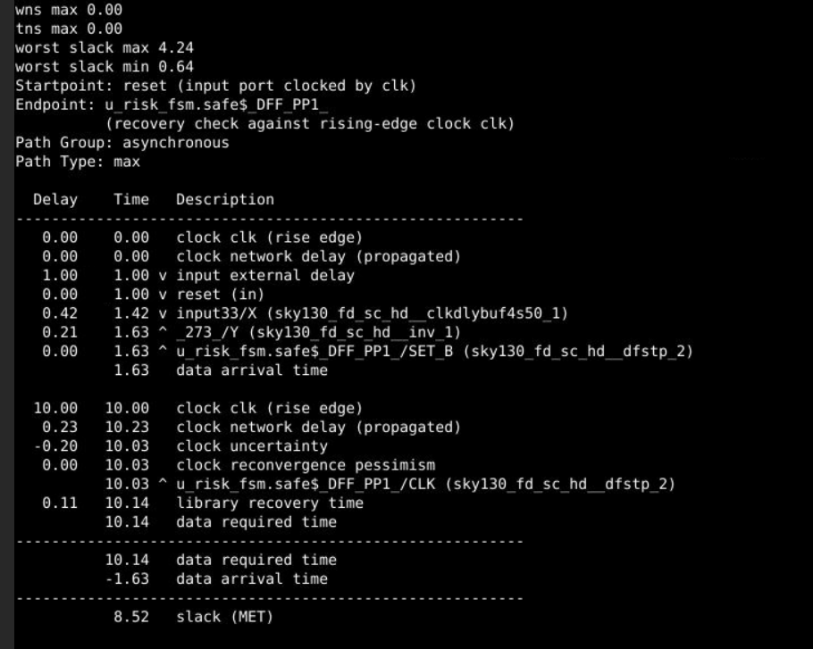
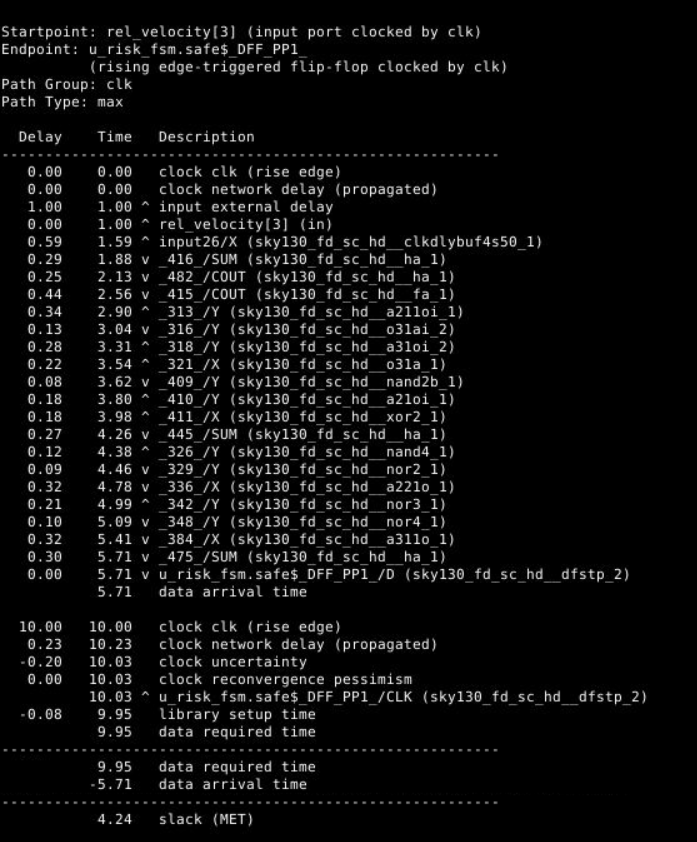
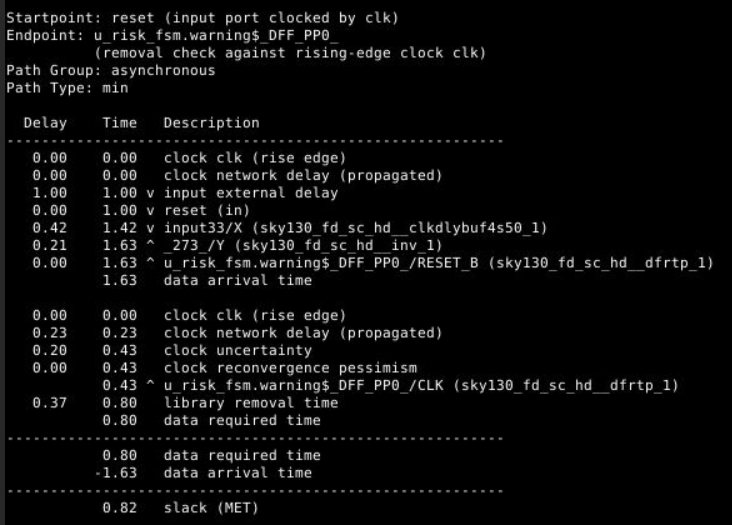
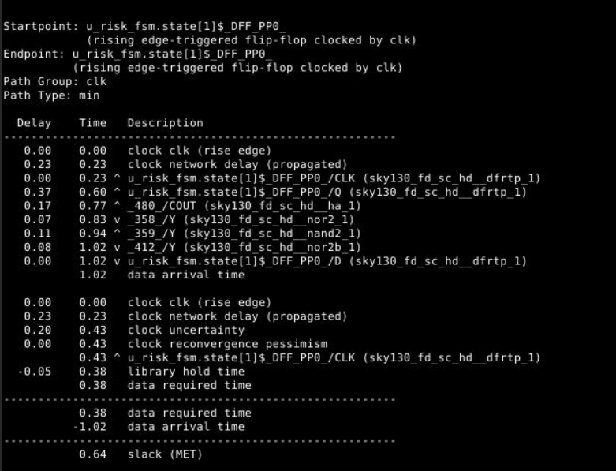

## PHYSICAL_DESIGN & POST STA

### 01. OpenROAD Flow Synthesis Execution
To perform physical synthesis and automated ASIC flow execution using the OpenROAD-flow-scripts framework, the environment is sourced and the synthesis Makefile target is invoked for the collision risk design.

#### **Execution Steps:**
* **Environment Initialization:**

   source env.sh

  cd flow

  make DESIGN_CONFIG=./designs/sky130hd/collision_risk/config.mk synth

### 02. OpenROAD Floorplan Flow Execution

Following physical synthesis, the floorplanning stage is initiated to establish the core dimensions, site definitions, pin placements, and power distribution network grid using the OpenROAD-flow-scripts framework.

  

#### **Execution Details:**
* **Command Invocation:**
 
  make DESIGN_CONFIG=./designs/sky130hd/collision_risk/config.mk floorplan

### 03. OpenROAD GUI Floorplan Visualization

To visually inspect the generated floorplan, core boundary placement, and pin constraints, the OpenROAD graphical user interface target is invoked.

#### **GUI Floorplan Command:**

make DESIGN_CONFIG=./designs/sky130hd/collision_risk/config.mk gui_floorplan

## 04. OpenROAD GUI Floorplan View & Analysis

The OpenROAD graphical user interface provides a visual layout of the core area, standard cell placement rows, and routing tracks for the floorplanned design.

#### **GUI & Scripting Log Analysis:**
* **Active Window Context:** `sky130hd/collision_risk_top/base - 2_floorplan - collision_risk_top` with a `10µm` grid scale.
* **Timing & Chart Queries:**
  * Executed `sta::find_timing` and `sta::find_requires` to evaluate initial timing relationships.
  * Selected the `"Endpoint Slack"` chart via `gui::select_chart` and updated the timing report.
* **Console Warnings & Errors:**
  * **Unpopulated Heat Maps:** `[WARNING GUI-0066]` notes that Routing Congestion, Estimated Congestion (RUDY), and IR Drop heat maps have not yet been populated since global routing and detailed placement are performed in subsequent flow steps.
  * **Placement Status:** `[ERROR GRT-0010] Instance _482_ is not placed`, indicating that standard cell placement must be successfully completed before global routing and advanced signoff metrics can be generated.

## 05. OpenROAD Placement Flow Execution

To resolve unplaced instances (such as instance `_482_` noted during floorplan inspection) and prepare the design for routing, the standard cell placement target is invoked.

#### **Execution Details:**
* **Command Invocation:**
  
  make DESIGN_CONFIG=./designs/sky130hd/collision_risk/config.mk place
  
* **Flow Stage Objective:** Performs global and detailed standard cell placement within the defined core area, optimizing wirelength and meeting timing constraints for the Sky130 high-density PDK environment.

## 06. OpenROAD GUI Placement Execution

To visually verify the standard cell placement results across the core area, the OpenROAD graphical user interface target for placement is invoked

#### **Command Invocation:**

make DESIGN_CONFIG=./designs/sky130hd/collision_risk/config.mk gui_place

## 07. OpenROAD GUI Placement View & Analysis

The OpenROAD graphical user interface displays the completed standard cell placement results, highlighting cell distribution, layer stack options, and post-placement timing extraction metrics.

#### **GUI & Scripting Log Analysis:**
* **Active Window Context:** `sky130hd/collision_risk_top/base - 3_place - collision_risk_top` showcasing the core area with standard cell placement density and interconnect layers (`li1`, `mcon`, `met1`, `via`, `met2`, `via2`, `met3`, `via3`, `met4`, `via4`, `met5`)
* **Database & Constraints Loading:** 
  * Loaded placement database: `read_db ./results/sky130hd/collision_risk_top/base/3_place.odb`
  * Sourced timing constraints and RC parasitics: `read_sdc .../3_place.sdc` and `estimate_parasitics -placement`
* **Timing & Metric Queries:**
  * Executed `sta::find_timing` and `sta::find_requires` to evaluate post-placement timing relationships
  * Updated the `"Endpoint Slack"` chart via the GUI controller to confirm successful placement closure

## 08. OpenROAD Clock Tree Synthesis (CTS) Flow Execution

Following standard cell placement, the Clock Tree Synthesis (CTS) stage is initiated to build a balanced clock distribution network, minimizing skew and insertion delay across all sequential elements using the OpenROAD-flow-scripts framework.

#### **Execution Details:**
* **Command Invocation:**
  
  make DESIGN_CONFIG=./designs/sky130hd/collision_risk/config.mk cts

## 09. OpenROAD GUI Clock Tree Synthesis Execution

To visually inspect the synthesized clock network, buffer insertion, and clock tree routing distribution across sequential elements, the OpenROAD graphical user interface target for CTS is invoked. 

#### **Command Invocation:**

make DESIGN_CONFIG=./designs/sky130hd/collision_risk/config.mk gui_cts

## 10. OpenROAD GUI CTS View & Power Density Analysis

The OpenROAD graphical user interface displays the clock tree synthesis results, focusing on power density distribution and post-CTS database metrics.

#### **GUI & Scripting Log Analysis:**
* **Active Window Context:** `sky130hd/collision_risk_top/base - 4_cts - collision_risk_top` displaying the power density heatmap overlay with a `10µm` grid reference.
* **Database & Constraints Loading:** 
  * Loaded CTS database: `read_db ./results/sky130hd/collision_risk_top/base/4_cts.odb`
  * Sourced CTS constraints and RC parasitics: `read_sdc .../4_cts.sdc`, `setRC.tcl`, and `estimate_parasitics -placement`
* **Timing & Metric Queries:**
  * Executed `sta::find_timing` and `sta::find_requires` to evaluate clock tree timing.
  * Updated the `"Endpoint Slack"` chart via the GUI controller to verify timing closure post-CTS.
 

## 11. OpenROAD Routing Flow Execution

Following clock tree synthesis, the detailed routing stage is initiated to establish physical interconnects between all standard cells and macro blocks using the OpenROAD-flow-scripts framework.

#### **Execution Details:**
* **Command Invocation:**

  make DESIGN_CONFIG=./designs/sky130hd/collision_risk/config.mk route

## 12. OpenROAD GUI Routing Execution

To visually verify the completed detailed routing, metal layer connectivity, and layout integrity across the chip, the OpenROAD graphical user interface target for routing is invoked

#### **Command Invocation:**

make DESIGN_CONFIG=./designs/sky130hd/collision_risk/config.mk gui_route

## 13. OpenROAD GUI Routing View & Analysis

The OpenROAD graphical user interface displays the completed detailed routing results, highlighting full metal layer interconnects and post-routing verification metrics.

#### **GUI & Scripting Log Analysis:**
* **Active Window Context:** `sky130hd/collision_risk_top/base - 5_route - collision_risk_top` displaying the fully routed layout with a `3µm` grid reference.
* **Database & Constraints Loading:** 
  * Sourced constraints and parasitics: `read_sdc .../5_route.sdc`, `setRC.tcl`, and `estimate_parasitics -global_routing`.
* **Timing & Metric Queries:**
  * Verified global routing existence via `grt::have_routes`.
  * Executed `sta::find_timing` and `sta::find_requires` to evaluate post-route timing closure.
  * Updated the `"Endpoint Slack"` chart via the GUI controller to confirm zero timing violations across all routed paths.

## 14. Post-Route Static Timing Analysis Script Verification

To verify and configure post-route static timing analysis (STA), the existence of the TCL automation script is confirmed and opened for editing within the OpenROAD flow environment.

#### **Execution Details:**
* **File Verification:**
  
ls post_route_sta.tcl
vim post_route_sta.tcl

## 15. Post-Route Static Timing Analysis Script Configuration

The `post_route_sta.tcl` script is configured to load the Sky130 high-density liberty files, post-route database, SDC constraints, and extracted RC parasitics to generate comprehensive signoff reports.

#### **Command Breakdown:**
* **Library & Database Loading:**
  * `read_liberty platforms/sky130hd/lib/sky130_fd_sc_hd__tt_025C_1v80.lib`: Loads the typical-case PVT library file for the Sky130 high-density standard cell library.
  * `read_db results/sky130hd/collision_risk_top/base/5_route.odb`: Imports the fully routed design database.
  * `read_sdc results/sky130hd/collision_risk_top/base/5_route.sdc`: Loads the routing-stage timing constraints.
* **Parasitics & Extraction:**
  * `source platforms/sky130hd/setRC.tcl`: Sets up resistance and capacitance scaling parameters.
  * `estimate_parasitics -global_routing`: Extracts parasitic RC values based on the global routing topology.
* **Signoff Reporting Commands:**
  * `report_wns` & `report_tns`: Reports Worst Negative Slack and Total Negative Slack.
  * `report_worst_slack -max` & `report_worst_slack -min`: Evaluates setup and hold timing margins.
  * `report_checks -path_delay max` & `report_checks -path_delay min`: Details critical setup and hold paths.
  * `report_power`: Calculates total dynamic and leakage power consumption.
  * `report_design_area`: Outputs final utilization and layout footprint dimensions.

## 16. Post-Route Static Timing Analysis Batch Execution

To execute the configured signoff checks and generate formal timing and power metrics, the OpenROAD binary is invoked in batch mode using the `post_route_sta.tcl` script.

#### **Command Breakdown & Execution Details:**
* **Command Invocation:**
  
  openroad -exit post_route_sta.tcl 2>&1 | tee post_route_sta.log

* **Execution Flow:**
  * **`openroad -exit post_route_sta.tcl`**: Runs the OpenROAD tool in non-interactive batch mode, executes all commands defined within `post_route_sta.tcl`, and exits upon completion.
  * **`2>&1 | tee post_route_sta.log`**: Redirects standard error to standard output and pipes the complete text stream into `tee` to simultaneously display the logs in the terminal and save them to `post_route_sta.log` for signoff archiving.

## 17. Post-Route STA Timing Signoff & Slack Analysis

Following the post-route STA batch execution, the resulting timing reports confirm successful timing closure across all path groups with zero negative slack.

  
#### **STA Timing Report (`max_ass`):**

#### **Timing Summary & Path Breakdown:**
* **Global Slack Metrics:**
  * **WNS Max:** `0.00`(Worst Negative Slack is fully closed).
  * **TNS Max:** `0.00` (Total Negative Slack is zero).
  * **Worst Slack Max:** `4.24 ns`
  * **Worst Slack Min:** `0.64 ns`

* **Critical Path Details (Asynchronous Recovery Check):**
  * **Startpoint:** `reset` (input port clocked by `clk`).
  * **Endpoint:** `u_risk_fsm.safe$_DFF_PP1_` (recovery check against rising-edge clock `clk`).
  * **Path Group:** `asynchronous`.
  * **Path Type:** `max`.
  * **Data Arrival Time:** `1.63 ns` (comprising input external delay, clock network delay, buffer `sky130_fd_sc_hd_clkdlybuf4s50_1`, and inverter `sky130_fd_sc_hd_inv_1`).
  * **Data Required Time:** `10.14 ns` (accounting for clock rise edge, network delay, clock uncertainty, and library recovery time for `sky130_fd_sc_hd_dfstp_2`).
  * **Final Margin:** **`8.52 ns (MET)`**, confirming robust timing closure on asynchronous reset paths.

## 18. Post-Route STA Clock Path Timing & Setup Analysis

Following the asynchronous path check, the post-route STA reports validate timing closure on synchronous clock-driven logic paths under maximum path delay conditions.

#### **STA Timing Report (`max_clk`):**

#### **Timing Summary & Path Breakdown:**
* **Path Identification:**
  * **Startpoint:** `rel_velocity[3]` (input port clocked by `clk`).
  * **Endpoint:** `u_risk_fsm.safe$_DFF_PP1_` (rising edge-triggered flip-flop clocked by `clk`).
  * **Path Group:** `clk`.
  * **Path Type:** `max`.

* **Data Arrival & Required Calculations:**
  * **Data Arrival Time:** `5.71 ns`, traversing input delay, clock buffer (`sky130_fd_sc_hd_clkdlybuf4s50_1`), and a chain of combinational arithmetic and logic gates (`ha_1`, `fa_1`, `a21loi_1`, `o3lai_2`, `a3loi_2`, `o3la_1`, `nand2b_1`, `a21oi_1`, `xor2_1`, `nand4_1`, `nor2_1`, `a221o_1`, `nor3_1`, `nor4_1`, `a31lo1_1`).
  * **Data Required Time:** `9.95 ns`, derived from the rising clock edge (`10.00 ns`), propagated network delay (`0.23 ns`), clock uncertainty (`-0.20 ns`), and library setup time (`-0.08 ns`).

* **Final Setup Margin:** **`4.24 ns (MET)`**, demonstrating positive setup slack and verified timing closure for synchronous operations across the design.

## 19. Post-Route STA Asynchronous Removal Timing Analysis

Following the setup checks, the post-route STA reports evaluate the minimum path delay conditions to verify removal timing margins on asynchronous reset paths.

#### **STA Timing Report (`min_ass`):**

#### **Timing Summary & Path Breakdown:**
* **Path Identification:**
  * **Startpoint:** `reset` (input port clocked by `clk`).
  * **Endpoint:** `u_risk_fsm.warning$_DFF_PP0_` (removal check against rising-edge clock `clk`).
  * **Path Group:** `asynchronous`.
  * **Path Type:** `min`.

* **Data Arrival & Required Calculations:**
  * **Data Arrival Time:** `1.63 ns`, traversing input delay, clock buffer (`sky130_fd_sc_hd_clkdlybuf4s50_1`), and inverter (`sky130_fd_sc_hd_inv_1`) driving the `RESET_B` pin of `sky130_fd_sc_hd_dfrtp_1`.
  * **Data Required Time:** `0.80 ns`, derived from the clock edge (`0.00 ns`), propagated network delay (`0.23 ns`), clock uncertainty (`0.20 ns`), and library removal time (`0.37 ns`).

* **Final Removal Margin:** **`0.82 ns (MET)`**, confirming positive hold/removal slack and ensuring clean reset de-assertion without metastable conditions.

## 20. Post-Route STA Clock Path Hold Timing Analysis

Following the removal checks, the post-route STA reports evaluate the minimum path delay conditions across synchronous clock paths to verify hold timing margins.

#### **STA Timing Report (`min_clk`):**

#### **Timing Summary & Path Breakdown:**
* **Path Identification:**
  * **Startpoint:** `u_risk_fsm.state[1]$_DFF_PP0_` (rising edge-triggered flip-flop clocked by `clk`).
  * **Endpoint:** `u_risk_fsm.state[1]$_DFF_PP0_` (rising edge-triggered flip-flop clocked by `clk`).
  * **Path Group:** `clk`.
  * **Path Type:** `min`.

* **Data Arrival & Required Calculations:**
  * **Data Arrival Time:** `1.02 ns`, traversing the register output Q pin of `sky130_fd_sc_hd_dfrtp_1`, half-adder (`sky130_fd_sc_hd_ha_1`), and combinational logic gates (`nor2_1`, `nand2_1`, `nor2b_1`) to arrive at the D pin.
  * **Data Required Time:** `0.38 ns`, derived from the clock edge (`0.00 ns`), propagated network delay (`0.23 ns`), clock uncertainty (`0.20 ns`), and library hold time (`-0.05 ns`).

* **Final Hold Margin:** **`0.64 ns (MET)`**, confirming positive hold slack and validating that fast path racing conditions are completely avoided across synchronous register loops.

## 21. Post-Route Power and Area Signoff Summary

The final power and area report provides the total power breakdown across sequential, combinational, and clock network groups, alongside silicon footprint utilization metrics.

#### **Power Consumption Breakdown:**
* **Sequential Logic:** Total power of `3.49e-05 W` (`13.7%`), comprising `2.98e-05 W` internal power, `5.11e-06 W` switching power, and `6.10e-11 W` leakage power.
* **Combinational Logic:** Total power of `1.79e-04 W` (`70.6%`), comprising `8.27e-05 W` internal power, `9.64e-05 W` switching power, and `1.09e-09 W` leakage power.
* **Clock Network:** Total power of `3.98e-05 W` (`15.7%`), comprising `2.76e-05 W` internal power, `1.22e-05 W` switching power, and `2.28e-11 W` leakage power.
* **Macro & Pad:** `0.0 W` (`0.0%`).

#### **Total Power & Physical Metrics:**
* **Total Power:** `2.54e-04 W` (`100.0%`), distributed as `1.40e-04 W` (`55.2%`) internal power, `1.14e-04 W` (`44.8%`) switching power, and `1.18e-09 W` (`0.0%`) leakage power.
* **Design Area:** `2258 µm²`.
* **Core Utilization:** `23%`.

## 22. Post-Route Log Timing Extraction Summary

To quickly verify and summarize the global signoff metrics from the complete execution, the post-route STA log file is parsed for WNS, TNS, and worst slack parameters.

#### **Command Breakdown & Extracted Metrics:**
* **Command Invocation:**
* 
  grep -i -A2 "wns\|tns\|worst slack" post_route_sta.log

## Log Output Summary:
1.wns max 0.00: Confirms zero worst negative slack across the design.

2.tns max 0.00: Confirms zero total negative slack across all endpoints.

3.worst slack max 4.24: Highlights the maximum positive setup slack margin.

4.worst slack min 0.64: Highlights the minimum positive hold slack margin.

5.Critical Path Header: Captures the initial lines of the critical asynchronous path leading to u_risk_fsm.safe$_DFF_PP1_.

